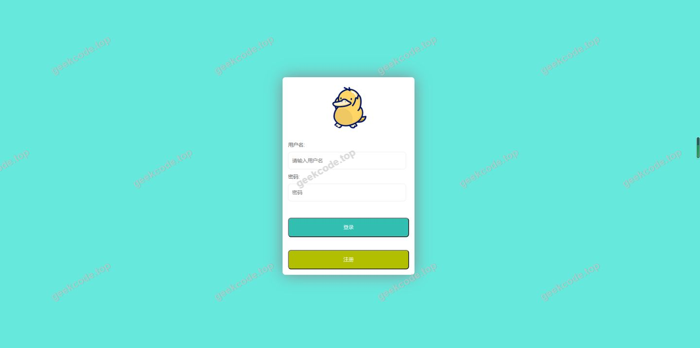
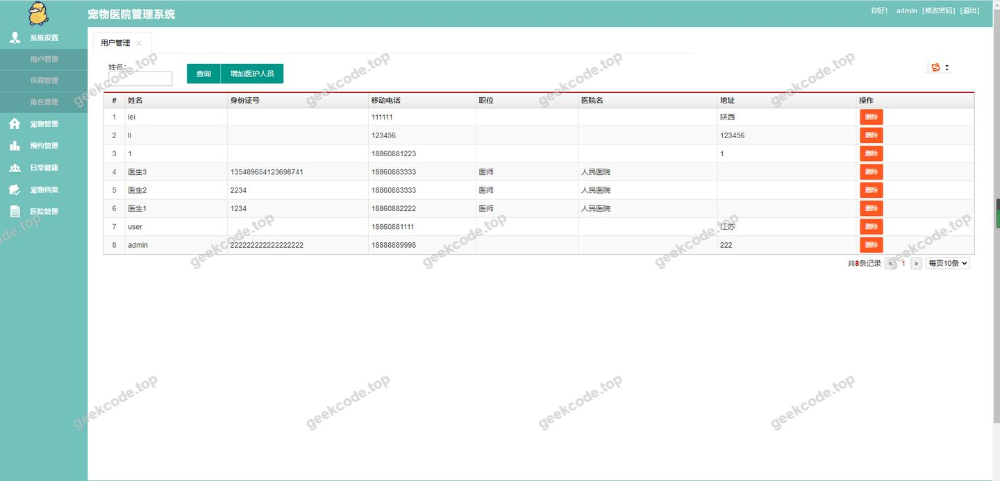
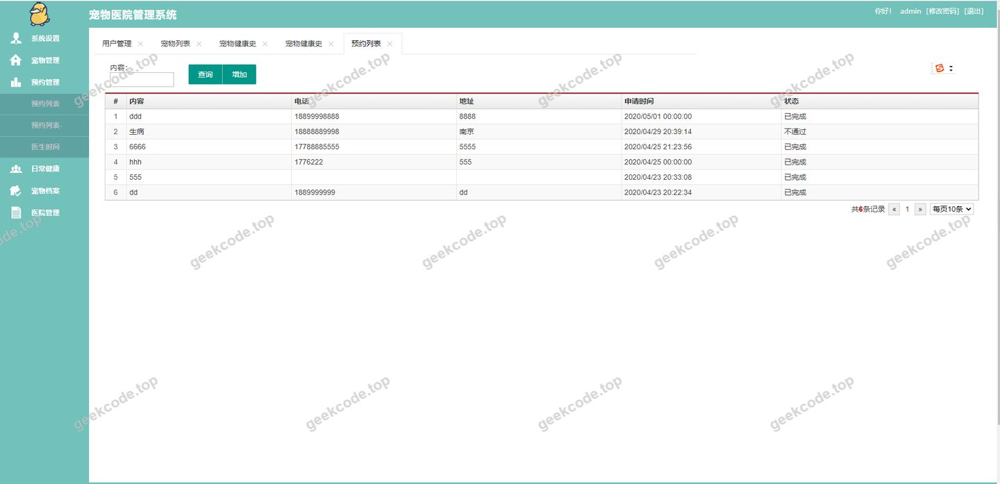
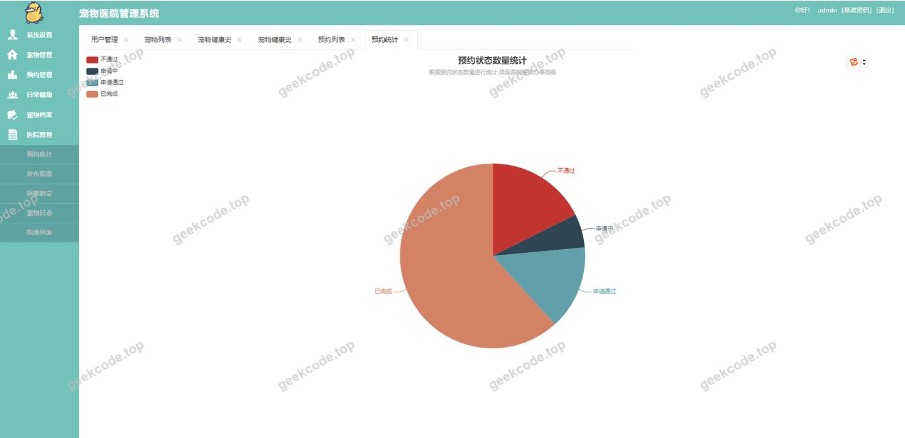
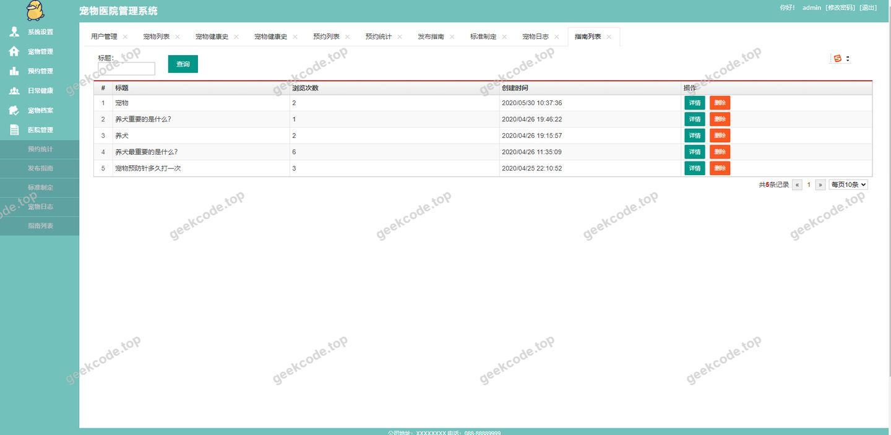

# java精品项目-宠物医院管理系统

> 🎓 **计算机毕业设计 · java精品项目-宠物医院管理系统**
>
> 本仓库只放**项目介绍 + 运行截图**（截图是站点带水印的原图，存在仓库 `images/` 里）。
>
> 👉 **完整可运行源码 / 数据库脚本 / 部署文档：[点我获取](https://geekcode.top/archives/java%E7%B2%BE%E5%93%81%E9%A1%B9%E7%9B%AE-%E5%AE%A0%E7%89%A9%E5%8C%BB%E9%99%A2%E7%AE%A1%E7%90%86%E7%B3%BB%E7%BB%9F?utm_source=github)**
>
> 💬 咨询微信：**ir9372**　|　🌐 更多项目：[极客代码 geekcode.top](https://geekcode.top/?utm_source=github)
>
> 📌 项目详情页：<https://geekcode.top/archives/java%E7%B2%BE%E5%93%81%E9%A1%B9%E7%9B%AE-%E5%AE%A0%E7%89%A9%E5%8C%BB%E9%99%A2%E7%AE%A1%E7%90%86%E7%B3%BB%E7%BB%9F?utm_source=github>

<table><td width="230" align="center"> <b>扫码加微信 ir9372</b></td><td valign="middle">📦 源码 = 项目介绍 + 全部运行截图 + 数据库 + 部署文档 👉 点上方任意截图，直接跳到 <b>极客代码 geekcode.top</b> 详情页</td></table>

---

<h1>java精品项目-宠物医院管理系统</h1>
<h2>项目概述</h2>

本项目为“宠物医院管理系统”，旨在通过数字化手段优化宠物医院的业务流程与管理效率。系统基于 Spring Boot 框架构建，采用前后端分离或模板渲染模式（依据技术栈推断为服务端渲染），核心功能涵盖基础数据管理与业务逻辑处理。适用场景主要为中小型宠物诊所的日常运营、客户管理及医疗服务记录。技术架构上，后端采用 Java 语言结合 MyBatis-Plus 进行持久层开发，使用 Shiro 框架实现安全认证与授权，前端页面由 Thymeleaf 模板引擎驱动，数据库连接池选用高性能的 Druid。该项目致力于提供稳定、高效且安全的后台管理解决方案，满足宠物医院对信息化管理的基本需求。

<h2>技术架构</h2>

本系统采用经典的 MVC 分层架构设计，确保代码的高内聚低耦合。

<strong>后端架构：</strong>

<ol>
<li><strong>核心框架</strong>：使用 Spring Boot 作为应用骨架，简化配置并快速启动。集成 <code>spring-boot-starter-thymeleaf</code> 和 <code>freemarker</code> 用于视图层渲染，支持动态 HTML 生成。</li>
<li><strong>持久层</strong>：采用 MyBatis-Plus (<code>mybatis-plus-boot-starter</code>) 作为 ORM 框架，配合 <code>mybatis-plus-generator</code> 提高代码生成效率。使用 PageHelper 插件实现物理分页查询，提升大数据量下的检索性能。</li>
<li><strong>安全模块</strong>：引入 Apache Shiro (<code>shiro-spring</code>) 进行身份验证（Authentication）、授权（Authorization）以及会话管理，保障系统访问安全。</li>
<li><strong>数据库连接</strong>：使用 Alibaba Druid 连接池，具备强大的监控功能和防 SQL 注入能力，确保数据库交互的稳定性和可维护性。</li>
<li><strong>工具类库</strong>：依赖 <code>org.apache.commons.lang</code> 提供丰富的字符串及对象操作工具方法。</li>
</ol>

<strong>前端架构：</strong>
由于项目标记为 <code>html-static</code> 类型且无独立前台路由，推测前端主要依赖 Thymeleaf/Freemarker 在服务端渲染静态 HTML 资源。界面交互通过原生 JavaScript 或轻量级库完成，未提及复杂的 SPA（单页应用）框架如 Vue 或 React。

<strong>数据库设计要点：</strong>
基于 MyBatis-Plus 的特性，数据库表结构需遵循实体类映射规范。虽然具体表结构未在上下文中给出，但通常包含用户表、角色表、权限表以及业务相关的宠物档案、就诊记录等表。Druid 配置需关注连接池大小、超时时间及监控统计功能的开启。

<h2>功能模块</h2>

根据提供的上下文信息，项目明确标识“是否有前台: 否”、“是否有后台: 否”，且“前台导航菜单”、“个人中心菜单”、“后台路由”、“前台路由”均为空。截图列表仅标注为 <code>(front)</code> 但未提供具体功能描述文本。因此，严格基于现有信息，无法确定具体的业务功能模块名称（如“预约挂号”、“病历管理”等）。

然而，从技术选型（Shiro, MyBatis-Plus, Thymeleaf）可以推断系统具备以下基础通用能力模块：

<ol>
<li><strong>用户认证模块</strong>：基于 Shiro 实现的用户登录、登出、记住我等功能。</li>
<li><strong>权限控制模块</strong>：基于 Shiro 的角色与权限校验，拦截非法访问请求。</li>
<li><strong>数据展示模块</strong>：基于 Thymeleaf/Freemarker 的动态页面渲染，展示后端返回的业务数据。</li>
<li><strong>分页查询模块</strong>：基于 PageHelper 实现的数据列表分页显示。</li>
</ol>

<em>注：除上述基础技术支撑模块外，具体的宠物医院业务功能（如宠物建档、医生排班、收费管理等）在提供的元数据中未明确列出，故不予编造。</em>

<h2>用户角色与权限</h2>

项目引入了 Apache Shiro 安全框架，表明系统存在基于角色的访问控制机制。但由于上下文未提供具体的角色定义列表（如“超级管理员”、“普通员工”等）及其对应的权限集合，也无法从空的菜单和路由列表中获取具体权限分配细节。

根据 Shiro 的通用设计模式，系统理论上至少包含以下层级：

<ol>
<li><strong>匿名访客</strong>：仅可访问公开页面（若有），无法进入受保护的资源。</li>
<li><strong>已认证用户</strong>：通过登录验证后，拥有基本的系统访问权限。</li>
<li><strong>授权角色</strong>：不同角色拥有不同的 URL 访问权限或按钮级操作权限。</li>
</ol>

<em>鉴于信息缺失，无法列出具体的角色名称及其可访问的具体功能模块清单。</em>

<h2>项目特色与创新点</h2>
<ol>
<li><strong>安全性强化</strong>：集成 Apache Shiro 框架，提供了成熟且细粒度的安全控制方案，有效防止未授权访问和会话劫持风险，优于简单的 Filter 过滤方案。</li>
<li><strong>高性能数据访问</strong>：采用 Druid 数据库连接池，不仅提升了并发处理能力，还内置了 SQL 监控面板，便于开发者实时排查慢 SQL 和潜在的性能瓶颈。</li>
<li><strong>开发效率提升</strong>：利用 MyBatis-Plus 的代码生成器 (<code>mybatis-plus-generator</code>) 和通用 CRUD 封装，大幅减少了样板代码的编写时间，使开发人员能更专注于业务逻辑的实现。</li>
<li><strong>灵活的分页处理</strong>：引入 PageHelper 插件，实现了无需修改 Mapper 接口即可自动添加分页参数，简化了复杂查询的分页逻辑。</li>
</ol>
<h2>部署环境</h2>

为确保项目正常运行，建议准备以下软件环境：

<ol>
<li><strong>Java 运行环境</strong>：JDK 8 或 JDK 11（Spring Boot 版本兼容性建议参考具体 pom.xml，通常 LTS 版本较为稳定）。</li>
<li><strong>构建工具</strong>：Maven 3.x 或 Gradle，用于依赖管理和项目打包。</li>
<li><strong>数据库</strong>：MySQL 5.7 或 MySQL 8.0，需安装并配置好服务端口及用户权限。</li>
<li><strong>Web 服务器</strong>：内置 Tomcat（由 <code>spring-boot-starter-tomcat</code> 提供），无需单独安装外部 Web 容器；若生产环境需要，也可部署至 Nginx + Tomcat 集群。</li>
<li><strong>浏览器</strong>：主流现代浏览器（Chrome, Firefox, Edge）以支持 Thymeleaf 渲染的前端页面正常显示。</li>
</ol>
<h2>五、技术特性</h2>
<ul>
<li>使用 MyBatis-Plus 简化数据访问层开发</li>
<li>集成 Shiro 权限框架实现角色权限控制</li>
</ul>
<h2>六、功能模块截图</h2>
<h3>前台用户端</h3>
<h4>运行截图1</h4>

<h4>运行截图2</h4>

<h4>运行截图3</h4>

<h4>运行截图4</h4>

<h4>运行截图5</h4>

---

## 获取完整源码

| 项目 | 说明 |
| --- | --- |
| 项目名 | java精品项目-宠物医院管理系统 |
| 运行截图 | 本文 5 张（站点带水印原图，仓库 `images/` 目录） |
| 完整源码 | [https://geekcode.top/archives/java%E7%B2%BE%E5%93%81%E9%A1%B9%E7%9B%AE-%E5%AE%A0%E7%89%A9%E5%8C%BB%E9%99%A2%E7%AE%A1%E7%90%86%E7%B3%BB%E7%BB%9F?utm_source=github](https://geekcode.top/archives/java%E7%B2%BE%E5%93%81%E9%A1%B9%E7%9B%AE-%E5%AE%A0%E7%89%A9%E5%8C%BB%E9%99%A2%E7%AE%A1%E7%90%86%E7%B3%BB%E7%BB%9F?utm_source=github) |
| 咨询微信 | **ir9372**（备注：jingpin-yuanma） |
| 更多项目 | [极客代码 geekcode.top](https://geekcode.top/?utm_source=github) |

> 需要源码、部署、改配置、跑不起来等问题，加微信 ir9372 沟通，说明项目名即可。
